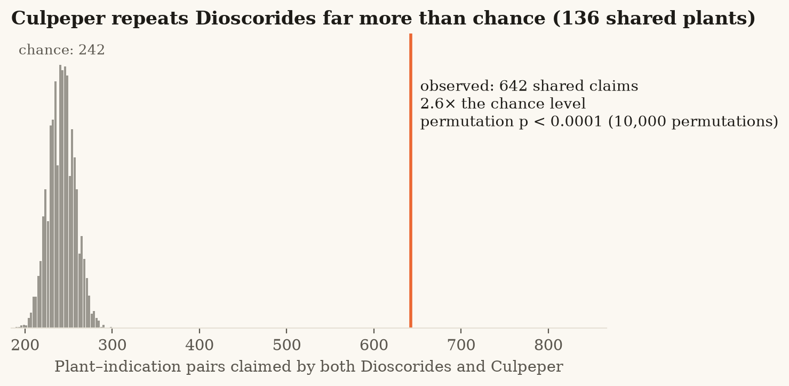
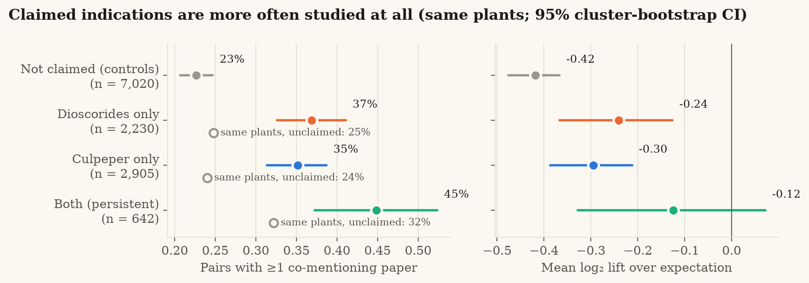
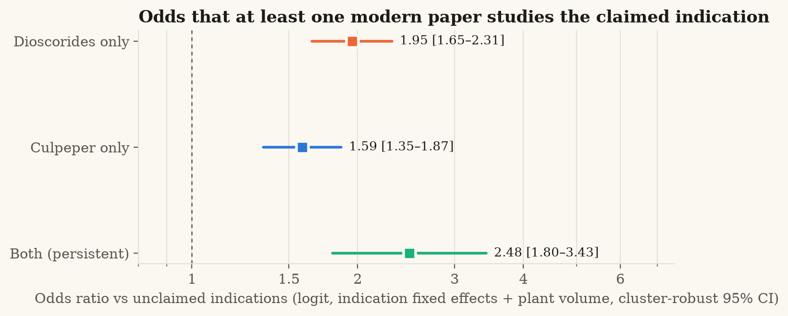

# Palimpsest

**Reading 2,000 years of herbal medicine against modern evidence.**
EthnoHack 2026 · Track 1 — Traditional knowledge (with bridges to Track 2 drug discovery and Track 3 conservation)

**Explorer:** https://karaaliosman.github.io/palimpsest/ · **Code & data:** this repository · **Methods:** [docs/METHODS.md](docs/METHODS.md) · **Related work:** [docs/related_work.md](docs/related_work.md)

> A palimpsest is a manuscript whose text was scraped off and written over — yet the older
> layer still shows through. European herbal medicine is exactly that: Culpeper (1653)
> wrote over Galen, who wrote over Dioscorides (c. 60 CE). Palimpsest recovers those layers
> computationally, from the **original Greek**, and asks which ancient claims survived
> 1,600 years of copying — and whether modern science has looked at them.

## Key results

| | |
|---|---|
| **Corpus** | 822 Greek chapters of Dioscorides + 328 Culpeper monographs → 692 accepted taxa (466 species in Dioscorides, 315 in Culpeper; 136 with claims in both) |
| **Claims** | 10,399 provenance-anchored indication mentions (85 MeSH-linked concepts) |
| **Extraction accuracy** (blind reference, 50 + 49 monographs) | Ancient Greek **F1 0.86** [0.81–0.89] (P 0.88, R 0.83) · Early Modern English **F1 0.9** [0.88–0.92] (P 0.9, R 0.9) |
| **Name concordance** | 99.2% resolved on the GBIF backbone; agreement with independent Wikidata Greek names 64%, with GBIF English names 72% (indicative checks) |
| **Modern evidence** | 12,797 plant–indication pairs queried against 48,227,744 Europe PMC records; 18,498 LOTUS constituents; knowledge graph of 20,425 nodes / 51,430 edges |

**1 · Knowledge persisted.** For the 136 species with claims in both herbals, Culpeper (1653)
repeats Dioscorides' (c. 60 CE) indication for the same plant **2.65× more often than chance**
(642 shared claims vs 242 expected; z = 26.1; label-permutation p < 0.0001). The effect survives
stricter nulls: **2.11×** when plants are only exchanged with plants of similar entry length, and
**1.56×** even within the same botanical family (both p < 0.001); genus level 2.39×,
high-confidence identifications only 2.49×. 36% of what Culpeper says about these plants
was already in Dioscorides (13% expected by chance).



**2 · Modern science has looked — but not hard.** Indications the herbals claim are more often studied at all
than the *unclaimed indications of the same plants*: persistent claims 45% vs 32%;
Dioscorides-only 37% vs 25%; Culpeper-only 35% vs 24%
(share of pairs with ≥ 1 co-mentioning paper). Logit with indication fixed effects and plant research volume,
cluster-robust: **OR 2.77 [2.04–3.77]** for persistent claims (p = 9e-11),
1.98 for Dioscorides-only, 1.65 for Culpeper-only; conditional logit 2.29;
within-plant Wilcoxon p = 1e-15. Yet **once studied, persistent claims are not studied more**: among pairs with
at least one paper, the rate ratio is 1.04 [0.61–1.76] (n.s.).
Tradition predicts *whether* modern research looked, not *how hard* — that gap is where the leads are.
Co-mention measures attention, not efficacy.
*Sensitivity:* re-searching every plant under all its GBIF synonyms (rosemary 211 → 2,179 papers) leaves the
conclusions intact: persistent-claim OR 2.48 [1.84–3.36], RR once studied 1.03 (n.s.), 55 of the 60 leads and all top 8
unchanged ([`results/sensitivity_synonyms/summary.md`](results/sensitivity_synonyms/summary.md), METHODS §8).




**3 · Leads.** 517 persistent pairs have ≤ 4 co-mentioning papers; the top 60
(diversified, [`results/tables/leads.csv`](results/tables/leads.csv)) combine persistence, LOTUS chemistry and a
volume-aware evidence gap, and must be supported by a chapter on the plant itself in both herbals. None is
assessed as threatened by IUCN (19 of 60 are assessed). ⚠ = the herbals themselves
record a warning about the plant.

| # | Plant | Indication | Mentions (D + C) | Papers | Known constituents | Safety |
|---|---|---|---|---|---|---|
| 1 | *Ruta graveolens* | Eye complaints / dim sight | 2 + 1 | 0 | 204 | ⚠ |
| 2 | *Vicia faba* | Bleeding / staunching blood | 1 + 1 | 0 | 297 | ⚠ |
| 3 | *Ocimum basilicum* | Venomous bites & stings | 2 + 3 | 0 | 268 |  |
| 4 | *Juglans regia* | Ulcers & sores | 1 + 4 | 0 | 190 | ⚠ |
| 5 | *Cannabis sativa* | Ear-ache / running ears | 1 + 2 | 1 | 528 | ⚠ |
| 6 | *Origanum vulgare* | Venomous bites & stings | 3 + 2 | 0 | 186 |  |
| 7 | *Brassica oleracea* | Constipation / purging | 3 + 1 | 0 | 258 | ⚠ |
| 8 | *Iris germanica* | Ulcers & sores | 3 + 2 | 0 | 129 | ⚠ |

*Computational hypotheses for laboratory follow-up — not medical advice.*

## What it does

```
 Dioscorides, De materia medica      Culpeper, Complete Herbal        Modern evidence (2026)
 Greek, c. 60 CE (822 chapters)      English, 1653 (328 monographs)   Europe PMC · ClinicalTrials.gov
            │                                   │                     LOTUS/Wikidata · GBIF · IUCN
            ▼                                   ▼                                │
   TEI parsing, apparatus removed      section-aware parsing                     │
            │                                   │                                │
            ▼                                   ▼                                │
   lemma → accepted binomial  ◄── cross-era name concordance (GBIF backbone) ──► │
            │                                   │                                │
            ▼                                   ▼                                │
   Ancient-Greek lexicon (accent-      Early-Modern-English historical          │
   free stems, idioms) → MeSH          disease crosswalk → MeSH                 │
            └───────────────┬───────────────────┘                                │
                            ▼                                                    ▼
             (plant, indication) claims with verbatim provenance ──► co-mention, lift, trials,
                            │                                         constituents, threat status
                            ▼
     transmission test · within-plant evidence models · ranked leads · knowledge graph · web explorer
```

1. **Corpus.** Parses Wellmann's critical edition of Dioscorides (First1KGreek TEI; we also
   repair a nesting bug that hides 199 chapters in the published XML) and Culpeper's herbal
   (Gutenberg #49513), keeping only the author's words.
2. **Cross-era name concordance.** Every Greek lemma and every Culpeper heading is mapped to an
   accepted taxon on the GBIF backbone, with confidence levels and justifications, and checked
   against independent Greek (Wikidata) and English (GBIF vernacular) names.
3. **Indication extraction in two historical languages.** Hand-built lexicons for Ancient Greek
   (inflection-proof stems on an accent-free, offset-preserving normalisation) and for
   17th-century English (a historical disease crosswalk: *agues, dropsy, king's evil, strangury,
   the whites…*) map to 85 MeSH-linked concepts. Every claim keeps its exact character span in
   the source. Accuracy is measured against a **blind** reference annotation.
4. **Transmission test.** A label-permutation test asks whether Culpeper repeats Dioscorides'
   indications for the same plant more often than chance.
5. **Modern-evidence test.** For each plant, claimed indications are compared with randomly
   sampled unclaimed ones *for the same plant* (conditional logistic regression, Poisson GLM
   with offsets, cluster bootstrap) — controlling for how much each plant and disease is studied.
6. **Leads.** Persistent but under-studied plant–indication pairs are ranked transparently,
   with phytochemistry (LOTUS), safety and conservation flags.
7. **Knowledge graph + explorer.** Everything is exported as a provenance-anchored knowledge
   graph (CSV/GraphML) and a research-grade web explorer with 95 public-domain images from the
   Vienna Dioscurides (c. 512 CE) and early printed herbals, era-layer views, accent-insensitive
   Greek search (Ctrl+K), cite/download for every record and a data/API page.

## Quick start

```bash
git clone https://github.com/KaraAliOsman/palimpsest && cd palimpsest
python -m venv .venv && . .venv/bin/activate        # Windows: .venv\Scripts\activate
pip install -r requirements.txt
export PYTHONPATH=src                                 # Windows PowerShell: $env:PYTHONPATH="src"

python -m palimpsest corpus extract evaluate          # offline, ~10 s, uses committed data
python -m palimpsest all                              # full pipeline incl. API queries (~30-60 min first run, cached after)
python -m pytest -m "not network"                     # offline test-suite
```

Web explorer (Node ≥ 20):

```bash
cd web && npm ci && npm run dev
```

Pipeline steps (`python -m palimpsest <step>`): `download → corpus → taxa → extract → evaluate →
evidence → naming → analyze → kg → web`. Every HTTP response is cached under `data/cache/`
(rate-limited, retried), so a second run is offline and deterministic. Numbers in this README
were produced on 2026-11-08; literature counts grow over time.

## Repository layout

| Path | Contents |
|---|---|
| `src/palimpsest/corpora/` | TEI parser for Dioscorides (incl. nesting repair), Culpeper parser |
| `src/palimpsest/textnorm.py` | length-preserving Ancient-Greek / English normalisation |
| `src/palimpsest/extract.py` | lexicon extractor with provenance spans, longest-match, negation |
| `src/palimpsest/taxa.py`, `naming.py` | GBIF resolution and independent name checks |
| `src/palimpsest/sources/` | cached, rate-limited clients: Europe PMC, ClinicalTrials.gov, GBIF, Wikidata, MeSH |
| `src/palimpsest/analysis/` | transmission test, modern-evidence models, leads, figures |
| `src/palimpsest/kg.py`, `export.py` | knowledge graph and web export |
| `data/lexicons/` | concept table (MeSH), Ancient-Greek and Early-Modern-English lexicons + audits |
| `data/curated/` | cross-era name concordance (one row per chapter/monograph, with justification) |
| `data/annotations/` | blind reference annotations (random samples, seed 2026) |
| `data/processed/` | claims, taxa, evidence, scored pairs, knowledge graph (`kg/`) |
| `results/` | `stats.json`, evaluation JSONs, tables (`tables/leads.csv` …), figures |
| `web/` | Vite + React + TypeScript explorer (deployed to GitHub Pages) |
| `docs/` | methods, data contract, related work, Devpost text, pitch material |

## Data sources and licences

| Source | Use | Licence |
|---|---|---|
| Dioscorides, *De materia medica*, ed. M. Wellmann (1906–1914), Open Greek and Latin / First1KGreek `tlg0656.tlg001.1st1K-grc1` | Greek text | CC BY-SA 4.0 |
| N. Culpeper, *The Complete Herbal*, Project Gutenberg #49513 (1850 London edition of the 1653 work) | English text | Public domain (US) |
| Europe PMC REST API | literature co-mention counts | free API; metadata reuse per EBI terms |
| ClinicalTrials.gov API v2 | trial counts | public domain (US Government) |
| GBIF backbone taxonomy & occurrence API | name resolution, occurrence counts | CC BY 4.0 |
| Wikidata (incl. LOTUS natural-product occurrences, IUCN status) | constituents, threat status, Greek names | CC0 |
| NLM MeSH | concept identifiers | NLM terms (free) |

Code: **MIT**. Derived data containing Greek text (`data/interim`, `data/processed`, web texts):
**CC BY-SA 4.0**, as required by the source. Curated tables and lexicons: CC BY 4.0; reference annotations (which quote Greek) CC BY-SA 4.0.

## Responsible research

* **These are computational hypotheses, not medical advice.** No output of this project
  establishes efficacy or safety. Several historical remedies are toxic.
* **Literature co-mention is not evidence of efficacy**, and modern research is partly
  motivated by tradition (circularity). See the limitations in [docs/METHODS.md](docs/METHODS.md#8-limitations-read-before-citing-any-number).
* **Traditional knowledge.** We use only published, public-domain or openly licensed
  European texts. No knowledge was collected from living communities, and no Indigenous
  knowledge is redistributed. Leads are presented with their historical provenance.
* **AI use, disclosed.** Plant identifications and the blind reference annotations were
  produced with AI assistance (Claude, Anthropic) from scholarly identifications and the
  texts themselves; they carry confidence levels and justifications and are open to expert
  correction. Extraction itself is rule-based and fully reproducible.

## Team

EthnoHack 2026 team *Palimpsest*. <!-- add team members -->

## Citation

```
Palimpsest: reading 2,000 years of European materia medica against modern evidence.
EthnoHack 2026. https://github.com/KaraAliOsman/palimpsest
```
