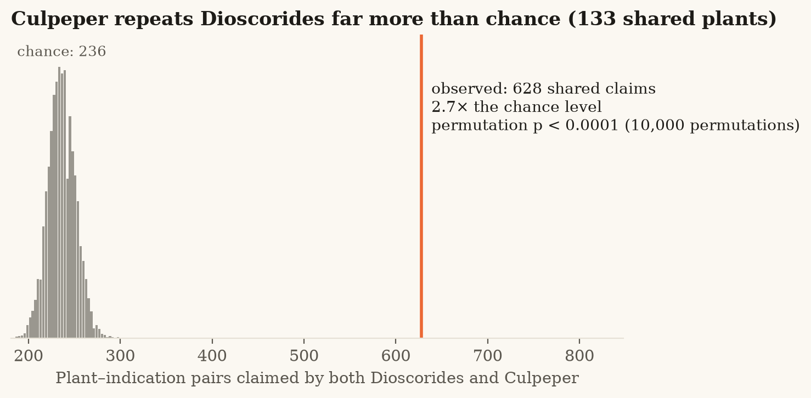
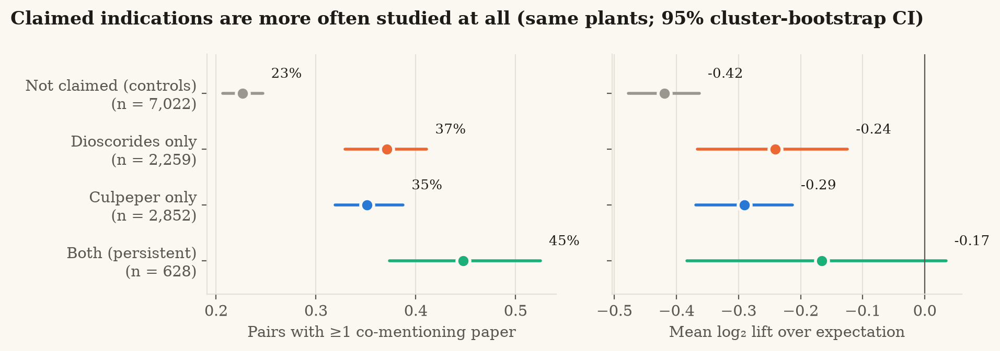
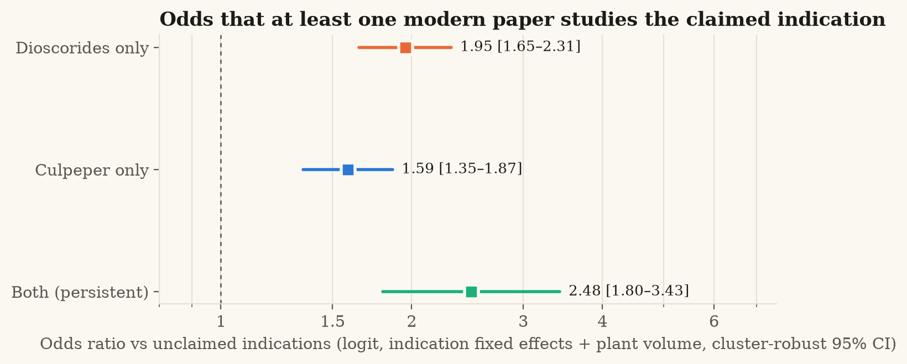

# Devpost submission text (copy-paste ready)

## Project title
Palimpsest — reading 2,000 years of herbal medicine against modern evidence

## Tagline (≤ 200 chars)
We read Dioscorides in the original Greek and Culpeper's 1653 herbal, map plants and diseases across eras, and test which ancient claims survived — and which modern science ignored.

## Challenge track
Track 1 — Traditional knowledge (bridges to Track 2 drug discovery and Track 3 conservation)

## Short description
Palimpsest is an open, reproducible pipeline, knowledge graph and web explorer that turns two
landmark herbals — Dioscorides' *De materia medica* (Greek, c. 60 CE) and Culpeper's *Complete
Herbal* (1653) — into provenance-anchored, MeSH-coded plant–indication claims, measures how
much knowledge was transmitted across 1,600 years, and screens every claim against the modern
literature, clinical trials, phytochemistry and conservation data.

## Results

| | |
|---|---|
| **Corpus** | 822 Greek chapters of Dioscorides + 328 Culpeper monographs → 693 accepted taxa (468 species in Dioscorides, 315 in Culpeper, 133 shared) |
| **Claims** | 10,299 provenance-anchored indication mentions (85 MeSH-linked concepts) |
| **Extraction accuracy** (blind reference, 50 + 49 monographs) | Ancient Greek **F1 0.86** (P 0.88, R 0.83) · Early Modern English **F1 0.9** (P 0.9, R 0.9) |
| **Name concordance** | 99.2% resolved on the GBIF backbone; independent agreement with Wikidata Greek names 64%, with GBIF English names 72% (lower bounds) |
| **Modern evidence** | 12,761 plant–indication pairs queried against 48,227,744 Europe PMC records; 18,534 LOTUS constituents; knowledge graph of 20,462 nodes / 51,365 edges |

**1 · Knowledge persisted.** For the 133 species present in both herbals, Culpeper (1653) repeats
Dioscorides' (c. 60 CE) indication for the same plant **2.66× more often than chance** (628 shared
claims vs 236 expected; z = 26.0; label-permutation p < 0.0001 (10,000 permutations)). 36% of what Culpeper
says about these plants was already in Dioscorides. Robust at genus level (2.4×) and with
high-confidence identifications only (2.5×).

**2 · Modern science has looked — but not hard.** Within the same plants, indications claimed by both herbals
have at least one co-mentioning modern paper in **45%** of cases vs **23%** for
unclaimed indications (logit with indication fixed effects and plant research volume, cluster-robust:
**OR 2.48 [1.8–3.43]**, p = 3e-08; Dioscorides-only 1.95, Culpeper-only
1.59; conditional logit 2.24; within-plant Wilcoxon p = 4e-16). Yet once studied,
persistent claims attract **no more papers than expected** (Poisson rate ratio 0.78
[0.35–1.74], n.s.). Tradition predicts *whether* modern research looked, not *how much* —
and that gap is where the leads are. Co-mention measures attention, not efficacy.

**3 · Leads.** 526 persistent pairs have ≤ 4 co-mentioning papers; the top 60 (diversified,
[`results/tables/leads.csv`](https://github.com/KaraAliOsman/palimpsest/blob/main/results/tables/leads.csv)) combine persistence, LOTUS chemistry and a volume-aware evidence gap.
None depends on an IUCN-threatened species. ⚠ = the herbals themselves record a warning for the plant.

| # | Plant | Indication | Mentions (D + C) | Papers | Known constituents | Safety |
|---|---|---|---|---|---|---|
| 1 | *Viscum album* | Boils / imposthumes / felons | 3 + 2 | 0 | 88 |  |
| 2 | *Triticum aestivum* | Venomous bites & stings | 3 + 4 | 0 | 274 | ⚠ |
| 3 | *Ocimum basilicum* | Venomous bites & stings | 2 + 7 | 0 | 268 |  |
| 4 | *Juglans regia* | Ulcers & sores | 1 + 5 | 0 | 190 | ⚠ |
| 5 | *Ruta graveolens* | Eye complaints / dim sight | 2 + 1 | 0 | 204 | ⚠ |
| 6 | *Triticum aestivum* | Freckles / spots / sunburn | 1 + 4 | 0 | 274 | ⚠ |
| 7 | *Plantago major* | Kidney & bladder complaints | 2 + 3 | 1 | 127 |  |
| 8 | *Foeniculum vulgare* | Eye complaints / dim sight | 3 + 2 | 4 | 384 |  |

*Computational hypotheses for laboratory follow-up — not medical advice.*

## Problem
Historical herbals are among the oldest structured records of human pharmacology, and they
are routinely cited as sources of drug leads. But using them computationally is hard:
plant names are ancient and ambiguous (what *is* Dioscorides' ἀψίνθιον?), disease
vocabulary is obsolete (*dropsy*, *king's evil*, *strangury*), the key texts are in
Ancient Greek, and most previous quantitative work relied on manual reading of later
translations without controls. Two questions remain open: **which claims persisted** across
the European tradition, and **does persistence carry any signal** that modern science
can use — or has it ignored?

## Our solution / approach
1. **Original-language corpus.** We parse Wellmann's critical edition of Dioscorides
   (First1KGreek TEI) — repairing an XML nesting bug that hides 199 chapters — and the
   Culpeper herbal, keeping only the authors' words.
2. **Cross-era name concordance.** Every Greek lemma and Culpeper heading is mapped to an
   accepted taxon on the GBIF backbone, with confidence levels and a written justification,
   and checked against independent Greek (Wikidata) and English (GBIF) names.
3. **Indication extraction in two historical languages.** An Ancient-Greek lexicon that is
   immune to inflection and accents (offset-preserving normalisation, so every claim keeps
   its exact Greek span) and a 17th-century English historical-disease crosswalk map
   statements to 85 MeSH-linked concepts. Accuracy is measured against a **blind** reference
   annotation.
4. **Transmission test.** A label-permutation test measures whether Culpeper repeats
   Dioscorides' indications for the same plant more than chance.
5. **Modern-evidence screen.** 10,000+ Europe PMC queries compare claimed indications with
   randomly sampled *unclaimed* indications of the same plant, using conditional logistic
   regression and Poisson models with plant and indication fixed effects (so neither plant
   popularity nor generally popular indications can drive the result).
6. **Leads.** Persistent but under-studied plant–indication pairs are ranked by a transparent
   score combining persistence, LOTUS phytochemistry, evidence gap and tractability, with
   historical-safety and IUCN flags.
7. **Knowledge graph + explorer.** All of it is exported as a provenance-anchored knowledge
   graph (CSV/GraphML; every claim edge carries its verbatim quote and character offsets)
   and an interactive web explorer.

## Technologies used
Python (pandas, NumPy, SciPy, statsmodels, NetworkX, matplotlib), TEI/XML parsing,
Ancient-Greek Unicode normalisation, regex-based information extraction, permutation tests,
conditional logistic and Poisson regression with fixed effects, cluster bootstrap; REST
clients with disk caching and rate limiting; SPARQL (Wikidata); React + TypeScript + Vite
web explorer on GitHub Pages; GitHub Actions CI. AI assistance (Claude) for plant-name
curation and blind reference annotation, disclosed in the repository.

## Data sources
* Dioscorides, *De materia medica*, ed. Wellmann — Open Greek and Latin / First1KGreek (CC BY-SA 4.0)
* N. Culpeper, *The Complete Herbal* — Project Gutenberg #49513 (public domain)
* Europe PMC REST API (titles, abstracts, keywords)
* ClinicalTrials.gov API v2
* GBIF backbone taxonomy and occurrence API (CC BY 4.0)
* Wikidata: LOTUS natural-product occurrences (P703), IUCN status (P141), Greek names (CC0)
* NLM MeSH

## Impact
* **For historians of medicine:** a quantitative, reproducible measure of how ancient
  pharmacological knowledge was transmitted — computed from the Greek, with every claim
  traceable to its passage.
* **For natural-product and drug-discovery researchers:** a ranked, explainable shortlist of
  persistent but under-studied plant–indication hypotheses, with known constituents attached.
* **For conservation:** IUCN and GBIF context for every medicinal plant, flagging leads that
  would depend on threatened species.
* **For the ETHCSTWIN community:** an open template — corpus parsers, lexicons, concept
  crosswalk, cached evidence clients and a knowledge graph — that extends to any herbal
  (Pliny, Galen, Byzantine and Arabic materia medica).

## Responsible research
Outputs are hypotheses, not medical advice; literature co-mention is a screening signal,
not proof of efficacy, and modern research is partly motivated by tradition (circularity).
Only published, openly licensed historical texts are used; no knowledge was collected from
living communities. AI assistance is disclosed and every AI-curated row carries a
confidence level and justification for expert correction.

## Future development
* Expert review of the name concordance with ETHCSTWIN pharmacognosists and historians.
* Add Galen, Pliny, Byzantine (e.g. Paul of Aegina) and Arabic sources to trace the full
  transmission chain, not just its endpoints.
* Replace co-mention with outcome-aware evidence (LLM-assisted classification of abstracts
  as positive/negative findings) and bioactivity data (ChEMBL targets of LOTUS constituents).
* Laboratory follow-up of top leads with natural-product chemistry partners.
* Publish the knowledge graph in RDF with Bioregistry/MeSH/Wikidata identifiers.

## Built with
python · pandas · statsmodels · scipy · networkx · react · typescript · vite · europe-pmc · gbif · wikidata · sparql · tei-xml · github-pages
