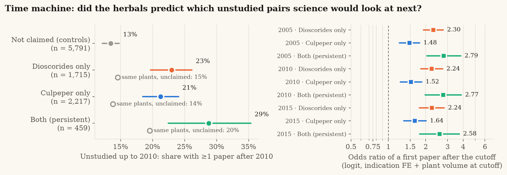

# Extensions (2026-11-08): expert benchmark, time machine, uncertainty, mechanism, tests ledger

These analyses extend the published pipeline. **None of them changes a primary number**
(`results/stats.json`, `results/key_numbers.json`, `data/processed/*.csv`, `results/tables/leads.csv`
are byte-identical before and after). Outputs live in `results/extensions/`,
`data/processed/extensions/` and, for the explorer, `web/public/data/extra/`. Every HTTP request goes
through the cached, rate-limited client (`src/palimpsest/sources/http.py`; GraphQL via
`sources/graphql.py`, built on it), so each script re-runs offline (`PALIMPSEST_OFFLINE=1`).
Offline tests: `tests/test_extensions.py`.

## P1 · Expert benchmark of the Dioscorides identifications

`scripts/expert_benchmark.py` · `src/palimpsest/sources/lardos.py`, `analysis/expert_benchmark.py` ·
[`results/extensions/expert_benchmark.md`](../results/extensions/expert_benchmark.md)

* **Gold:** Lardos et al. (2024), *J Ethnopharmacol* 322:117622 — 61 information-rich Dioscorides
  plants, every candidate species classified Strong / Moderate / Weak / not-in-flora by botanical
  congruence with Dioscorides' description, plus a 0–3 medicinal score. Licence CC BY 4.0 (figshare
  record verified via DataCite; article via Europe PMC).
* **Access:** every figshare host returns HTTP 403 to our network, so the raw figshare files could not be
  downloaded. The expert results (Tables 1–2) were parsed from the open-access JATS XML of the article
  (Europe PMC PMC7615571, CC BY).
* **Definitions (fixed before scoring):** unit = Dioscorides chapter (kinds pooled); expert top-1 = best
  botanical tier, ties broken by medicinal score; names GBIF-resolved on both sides; Wilson 95% CIs.
* **Results (54 chapters):** species = expert top-1 **70% (38/54) [0.57–0.81]**; restricted to our
  species-rank identifications 81% (38/47) [0.68–0.90]; genus **91% (49/54) [0.80–0.96]**; our species
  among the expert candidates 80%. By our confidence: high 77% (23/30), medium 70% (14/20), low 25% (1/4)
  at species level — confidence is informative. Row level (62 Lardos rows): species 63%, genus 90%.
  7 of the 16 species "misses" are deliberate genus-rank identifications of chapters that describe several
  species; the genuine disagreements (e.g. 4.1 κέστρον, 3.12 ἄκανθα λευκή, 1.90 ῥάμνος) are listed with
  notes.
* **Staples check:** the 30 commonest food and garden plants (barley *Hordeum vulgare*, lentil *Lens
  culinaris* = *Vicia lens*, wheat *Triticum*, olive, fig, grape, onion, garlic …) — **30/30 correct**.
* **Caveat:** the identifications were curated with AI assistance that may have seen Lardos et al. or the
  same scholarly sources; agreement measures consistency with expert scholarship, not independent blind
  re-identification.

## P5 · Time machine (pseudo-prospective test)

`scripts/time_machine.py fetch|analyze` · `sources/europepmc_years.py`, `analysis/time_machine.py` ·
[`results/extensions/time_machine.md`](../results/extensions/time_machine.md) ·

* **Question:** did the herbals *predict* later research? Every scored pair (claimed + 12 seeded unclaimed
  controls per plant) was re-counted in Europe PMC with publication-year windows. `PUB_YEAR:[1000 TO Y]` /
  `PUB_YEAR:[Y+1 TO 2100]` was verified to partition the counts exactly (wormwood 480 = 107 + 373;
  `FIRST_PDATE` also partitions, 109 + 371); window sums reproduce the published counts (33,327 vs 33,333).
* **Design (fixed before fetching):** risk set = pairs with 0 papers up to the cutoff whose plant already had
  papers; outcome = ≥ 1 paper after the cutoff; logit with indication fixed effects and the plant's
  research volume *at the cutoff*, cluster-robust by plant; secondary: + later plant volume, conditional
  logit (strata = plant), matched shares, within-plant Wilcoxon. Estimator checked on simulated data
  (recovers OR 2.55 for a true 2.5; null → CI covers 1).
* **Result — held at every cutoff.** Cutoff 2010: of 459 persistent pairs unstudied in 2010, **28.8%** gained a
  first paper by 2026 vs **19.6%** of the unclaimed indications of the same plants; **OR 2.77 [1.98–3.87]**,
  p = 2e-9 (Dioscorides-only 2.24, Culpeper-only 1.52); + later plant volume 2.85; conditional logit 2.32;
  within-plant Wilcoxon p = 4e-7. Cutoff 2005: OR 2.79 [2.04–3.83]; 2015: 2.58 [1.79–3.73].
* **Caveat:** pseudo-prospective — tradition may itself have motivated post-2010 studies (circularity is
  reduced, not removed), and co-mention measures attention, not efficacy.

## P4 · Uncertainty-weighted leads

`scripts/uncertainty_leads.py` · `analysis/uncertainty_leads.py` ·
[`results/extensions/uncertainty_leads.md`](../results/extensions/uncertainty_leads.md)

Weights high 1.0 / medium 0.6 / low 0.3 / genus-only 0.5; per herbal the best-identified supporting plant
chapter; lead certainty = weakest link of the two herbals; weighted score = score × certainty; same
diversification. Of 517 candidates 312 have certainty 1.0, 185 0.6, 20 0.3 (top 60: 43 / 17 / 0).
**Kendall τ-b 0.56** over all candidates (0.61 within the published top 60); **41 of 60** leads stay in
the top 60. Leads anchored on a medium-confidence identification drop out — including the published
#1, *Ruta graveolens* for the eyes (πήγανον is identified with medium confidence) — while #2–#5 become
#1–#4. The published ranking is kept as "rank if certainty ignored"; both scores are in
`web/public/data/extra/uncertainty_leads.json`.

## P10 · Mechanism paths and modern hazard (hypothesis-generating)

`scripts/mechanism.py` · `sources/chembl.py`, `sources/opentargets.py`, `sources/pubchem.py`,
`analysis/mechanism.py` · [`results/extensions/mechanism.md`](../results/extensions/mechanism.md)

LOTUS constituents → ChEMBL activities (pChEMBL ≥ 6, human single proteins; 6,755 activities, 335
targets) → Open Targets association (score ≥ 0.1) with the lead's disease (35 diseases mapped; venomous
bites and bruises have no Open Targets entity). **33 of 60 leads** have at least one path. A background
check shows the paths are **not specific**: the share of a plant's targets associated with the lead's
disease (median 3.5%) is no higher than for the other diseases (3.2%); above the plant's own median in
only 22 of 51 leads. PubChem GHS: 47 leads have a top constituent with a severe hazard statement, but the
flag is dominated by ubiquitous flavonoids (quercetin); counting only constituents found in < 25% of the
lead plants, 13 leads are flagged (7 of them also carry the herbals' own warning; 29 leads carry it).
Paths are screening aids, not evidence of efficacy.

## P7 · Tests ledger

`scripts/tests_ledger.py` · `analysis/ledger.py` → `web/public/data/extra/tests_ledger.json`,
[`results/extensions/tests_ledger.md`](../results/extensions/tests_ledger.md)

Every test in the project (transmission and its stricter nulls, modern-evidence presence and intensity
models, matched controls, intensity once studied, synonym sensitivity, extraction evaluation, naming
checks, expert benchmark, time machine, uncertainty, mechanism) with question → prediction → method →
result (read from the result files) → status (held / did not hold / null / indicative), whether the
criterion was stated a priori or post hoc, and a reproduce command. The ledger surfaces the honest
nulls: intensity rate ratios (RR 1.18 and, once studied, 1.04), the high-confidence intensity check, and
the non-specific mechanism paths.
