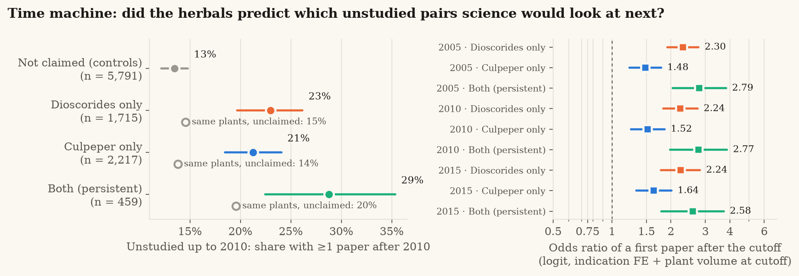

# P5 · Time-machine (pseudo-prospective) test

*Generated 2026-11-08 · reproduce: `PYTHONPATH=src python scripts/time_machine.py fetch` then `PYTHONPATH=src python scripts/time_machine.py analyze`*

**Question.** Did the herbals predict later research? Among plant-indication pairs with no paper up to a cutoff year, do claimed (especially persistent) pairs gain a first paper afterwards more often than unclaimed indications of the same plants?

**Verdict (held).** HELD: among plant-indication pairs unstudied up to 2010, pairs both herbals claim were more likely to receive their first paper afterwards than unclaimed indications of the same plants.

**Design.** Risk set: 0 co-mentioning papers up to the cutoff; plant itself has >= 1 paper up to the cutoff. Outcome: >= 1 co-mentioning paper published after the cutoff (to 2026-11-08). Primary model: logit, indication FE + log(1 + plant papers up to cutoff), cluster-robust by plant. Field: Europe PMC PUB_YEAR windows (verified to partition the counts).

## Cutoff 2005

Risk set: 10,531 pairs on 532 plants (2,411 gained ≥ 1 paper after 2005); by group {'unclaimed': 5865, 'cul_only': 2349, 'dsc_only': 1812, 'both': 505}.

| Group | n at risk | Gained a first paper | Same plants, unclaimed | Logit OR (primary) | + later plant volume | Conditional logit |
|---|---|---|---|---|---|---|
| unclaimed | 5,865 | 17.9% [16.2%–19.6%] | – | ref. | ref. | ref. |
| dsc_only | 1,812 | 29.6% [26.1%–33.4%] | 19.7% (n = 3,773) | 2.30 [1.92–2.77], p = 7.1e-19 | 1.68 [1.40–2.02], p = 2.6e-08 | 1.39 [1.17–1.65], p = 0.00021 |
| cul_only | 2,349 | 27.3% [24.2%–30.4%] | 18.3% (n = 3,125) | 1.48 [1.23–1.78], p = 3.4e-05 | 1.76 [1.47–2.09], p = 3.2e-10 | 1.76 [1.50–2.06], p = 2.6e-12 |
| both | 505 | 36.4% [30.3%–43.7%] | 25.0% (n = 1,254) | 2.79 [2.04–3.83], p = 1.5e-10 | 2.86 [2.09–3.91], p = 5.1e-11 | 2.33 [1.79–3.04], p = 3.8e-10 |

Within-plant Wilcoxon (claimed vs unclaimed share gaining, one-sided): n = 525 plants, mean difference +0.064, p = 1.1e-09; persistent only: n = 118, mean difference +0.118, p = 0.00061.

## Cutoff 2010

Risk set: 10,182 pairs on 549 plants (1,776 gained ≥ 1 paper after 2010); by group {'unclaimed': 5791, 'cul_only': 2217, 'dsc_only': 1715, 'both': 459}.

| Group | n at risk | Gained a first paper | Same plants, unclaimed | Logit OR (primary) | + later plant volume | Conditional logit |
|---|---|---|---|---|---|---|
| unclaimed | 5,791 | 13.5% [12.1%–14.8%] | – | ref. | ref. | ref. |
| dsc_only | 1,715 | 23.0% [19.7%–26.1%] | 14.6% (n = 3,674) | 2.24 [1.82–2.74], p = 7.9e-15 | 1.69 [1.39–2.06], p = 1.4e-07 | 1.42 [1.18–1.72], p = 0.00024 |
| cul_only | 2,217 | 21.2% [18.5%–24.1%] | 13.8% (n = 3,032) | 1.52 [1.25–1.86], p = 3.2e-05 | 1.75 [1.44–2.11], p = 9.2e-09 | 1.76 [1.48–2.09], p = 1.9e-10 |
| both | 459 | 28.8% [22.4%–35.3%] | 19.6% (n = 1,170) | 2.77 [1.98–3.87], p = 2.4e-09 | 2.85 [2.04–3.97], p = 7e-10 | 2.32 [1.73–3.09], p = 1.2e-08 |

Within-plant Wilcoxon (claimed vs unclaimed share gaining, one-sided): n = 540 plants, mean difference +0.054, p = 4e-07; persistent only: n = 117, mean difference +0.093, p = 0.005.

## Cutoff 2015

Risk set: 9,901 pairs on 562 plants (1,223 gained ≥ 1 paper after 2015); by group {'unclaimed': 5695, 'cul_only': 2134, 'dsc_only': 1640, 'both': 432}.

| Group | n at risk | Gained a first paper | Same plants, unclaimed | Logit OR (primary) | + later plant volume | Conditional logit |
|---|---|---|---|---|---|---|
| unclaimed | 5,695 | 9.4% [8.3%–10.5%] | – | ref. | ref. | ref. |
| dsc_only | 1,640 | 16.6% [13.9%–19.6%] | 9.9% (n = 3,540) | 2.24 [1.78–2.82], p = 8.5e-12 | 1.76 [1.42–2.19], p = 3.9e-07 | 1.45 [1.17–1.80], p = 0.00067 |
| cul_only | 2,134 | 15.7% [13.5%–18.0%] | 10.0% (n = 2,989) | 1.64 [1.33–2.02], p = 3.7e-06 | 1.84 [1.49–2.26], p = 8.4e-09 | 1.83 [1.51–2.23], p = 1.5e-09 |
| both | 432 | 18.5% [13.9%–23.9%] | 14.0% (n = 1,113) | 2.58 [1.79–3.73], p = 4.1e-07 | 2.49 [1.73–3.59], p = 9.2e-07 | 2.10 [1.50–2.93], p = 1.3e-05 |

Within-plant Wilcoxon (claimed vs unclaimed share gaining, one-sided): n = 548 plants, mean difference +0.046, p = 3.4e-06; persistent only: n = 116, mean difference +0.070, p = 0.043.

## Consistency checks

Year windows are monotone (≤2005 ≤ ≤2010 ≤ ≤2015 ≤ now) for every pair: True. Window sums equal the published (2026-11-08) count for 100.0% of pairs (sum 33,327 vs 33,333).

## Caveats

* Pseudo-prospective: the claims are ancient, but the controls and the indication vocabulary were chosen in 2026; co-mention measures attention, not efficacy.
* Later research may itself be motivated by the herbals (circularity is reduced, not removed).
* Pairs whose plant had no paper at all by the cutoff are excluded from the risk set.
* Counts are a 2026-11-08 snapshot; records indexed late can move between windows.
